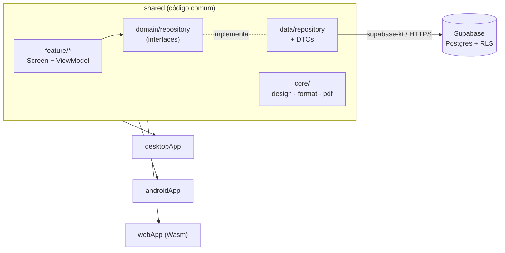

# clickOrçamento

**Sistema de orçamentos de serviço para pequenos prestadores, em Kotlin Multiplatform.** Um único código roda no **Windows/desktop, Android e navegador**, com backend no Supabase.


> 🚧 **Em desenvolvimento.** O fluxo principal (empresas → clientes → orçamento → PDF) já funciona. Faltam acabamentos de conta (troca de senha, sessão salva) e a publicação dos instaladores. Veja o [roteiro](#-roteiro).

---

## 💡 O problema

O orçamento era feito numa planilha do Excel: **cada orçamento era uma cópia de aba**. Isso significava redigitar os dados da empresa e do cliente toda vez, numerar na mão (com risco de repetir número), copiar dados bancários manualmente e não ter histórico pesquisável.

**O clickOrçamento resolve isso:** a empresa e os clientes são cadastrados uma vez, o número é gerado pelo banco, as condições de pagamento vêm preenchidas e o PDF sai pronto para enviar.

## ✨ Funcionalidades

| | |
|---|---|
| ✅ **Login e cadastro** | E-mail e senha (Supabase Auth), com etapa de confirmação de e-mail |
| ✅ **Várias empresas por usuário** | Para quem presta serviço com mais de um CNPJ; uma marcada como padrão |
| ✅ **Clientes** | Cadastro com máscara de CPF/CNPJ e telefone, busca |
| ✅ **Orçamentos** | Lista com busca e filtro por status, duplicar, editor com itens, desconto e totais calculados |
| ✅ **Numeração automática por empresa** | Gerada no banco, sem repetir nem pular |
| ✅ **PDF** | Gerador próprio em Kotlin puro; salvar (desktop), compartilhar (Android, inclusive WhatsApp) ou baixar (web) |
| ✅ **Tema claro e escuro** | Material 3 |
| ✅ **Layout responsivo** | Abas e tabelas no desktop; barra inferior e cartões no celular |
| 🔜 Troca e recuperação de senha, sessão salva ao fechar o app |
| 🔜 Instalador `.msi` e `.apk` para download, versão web publicada |

## 📸 Telas

<!-- Coloque os prints em docs/prints/ e descomente:
| Desktop | Celular |
|---|---|
|  |  |
-->

O design das telas (desktop e celular, claro e escuro) está em [`docs/mockups/telas-clickorcamento.html`](docs/mockups/telas-clickorcamento.html), e o guia de interface em [`docs/UI-UX.md`](docs/UI-UX.md).

## 🧱 Stack

| Camada | Tecnologia |
|---|---|
| Linguagem e UI | Kotlin 2.4 + **Compose Multiplatform 1.12** (Material 3) |
| Alvos | Desktop (JVM), Android (minSdk 26), Web (Kotlin/Wasm) |
| Backend | **Supabase**: Postgres, Auth e Row Level Security |
| Cliente | supabase-kt 3.8 (auth + postgrest), Ktor 3.5 com um engine por plataforma |
| Injeção de dependência | Koin |
| Navegação | Navigation Compose com rotas tipadas |
| Estado | ViewModel + `StateFlow` (lifecycle multiplataforma) |
| Testes | kotlin-test (JVM e Android) |

## 🏛️ Arquitetura



- **4 módulos:** `shared` concentra toda a UI e a lógica; `desktopApp`, `androidApp` e `webApp` são apenas pontos de entrada.
- **Por feature:** cada tela tem `UiState` (estado único e imutável), `ViewModel` e `Screen` (que separa a parte com estado de um `Conteudo` sem estado).
- **Camadas:** `feature` → `domain` (modelos e interfaces) ← `data` (Supabase e DTOs). O domínio não conhece o Supabase.
- **`expect`/`actual` só onde a plataforma obriga:** hoje, a entrega do PDF (diálogo "Salvar como" no desktop, folha de compartilhamento no Android, download no navegador).

## 🔍 Destaques técnicos

- **PDF sem biblioteca, igual nas 3 plataformas.** Gerador de PDF próprio em Kotlin puro (`core/pdf/`), usando as fontes padrão do formato e as larguras oficiais das letras (AFM), para quebrar linhas e alinhar valores à direita. Isso evitou manter três layouts diferentes (PDFBox, `PdfDocument` do Android, jsPDF). Inclui paginação que repete o cabeçalho da tabela e testes automatizados.
- **Dinheiro em centavos (`Long`)**, nunca `Double`, e **nenhum total gravado**: subtotal e total são sempre calculados, para nunca divergirem dos itens.
- **Segurança no banco:** Row Level Security em todas as tabelas (cada usuário só enxerga os próprios dados), policies otimizadas com `(select auth.uid())` e triggers que conferem o dono de cada referência entre tabelas.
- **Numeração por empresa no Postgres:** trigger com trava (`pg_advisory_xact_lock`) para dois orçamentos criados ao mesmo tempo não pegarem o mesmo número.
- **Histórico preservado:** as condições de pagamento são copiadas para o orçamento no momento da emissão. Mudar os dados bancários depois não altera orçamentos antigos.
- **Kotlin/Wasm na prática:** correção de um erro de runtime (`import.meta may only appear in a module`) causado pelo plugin de source map do webpack em modo de desenvolvimento ([`webApp/webpack.config.d/no-eval-devtool.js`](webApp/webpack.config.d/no-eval-devtool.js)).

## ▶️ Como rodar

**Requisitos:** JDK 17+ e Android SDK (para o alvo Android).

```bash
# Desktop
./gradlew :desktopApp:run

# Android (ou o botão Run da IDE)
./gradlew :androidApp:assembleDebug

# Web (abre em http://localhost:8080)
./gradlew :webApp:wasmJsBrowserDevelopmentRun

# Testes
./gradlew :shared:jvmTest
```

O app aponta para o projeto Supabase de desenvolvimento (`shared/.../data/remote/SupabaseConfig.kt`). A chave ali é a **publicável**, pública por definição: quem protege os dados é o RLS. As migrations ficam em [`supabase/migrations/`](supabase/migrations/).

## 📁 Estrutura

```
shared/src/commonMain/kotlin/com/clickorcamento/app/
├── core/        design (tema, componentes), format (moeda, datas, documentos), pdf
├── domain/      modelos e interfaces de repositório
├── data/        implementações com Supabase + DTOs
├── feature/     auth, configuracoes (empresas), cliente, orcamento (lista e editor)
├── navigation/  rotas tipadas, NavHost e casca responsiva
└── di/          módulos do Koin
```

## 🗺️ Roteiro

- [x] Login, cadastro e confirmação de e-mail
- [x] Empresas, clientes, orçamentos e PDF
- [x] Tema claro/escuro e layout responsivo
- [ ] Troca e recuperação de senha
- [ ] Sessão e preferência de tema salvas no dispositivo
- [ ] Versão web publicada e instaladores (`.msi` / `.apk`) nos Releases
- [ ] Envio do orçamento por e-mail

## 🤖 Como foi desenvolvido

Projeto pessoal em que aprendi Kotlin Multiplatform, vindo do Android nativo. Usei IA (Claude Code) como par de programação, com as decisões de arquitetura e o contexto do projeto documentados em um arquivo de contexto mantido junto do código.

## 👤 Autor

**Lucas Gabriel Silva** · Desenvolvedor Android (Kotlin + Jetpack Compose)
[GitHub](https://github.com/LucasSilvasx)

---

© 2026 Lucas Gabriel Silva. Todos os direitos reservados. O código está público para fins de portfólio; uso, cópia ou redistribuição dependem de autorização.
